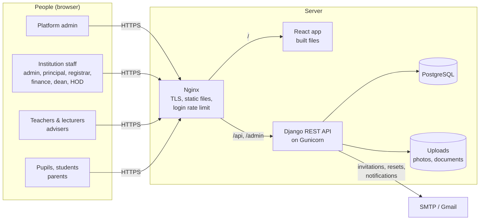
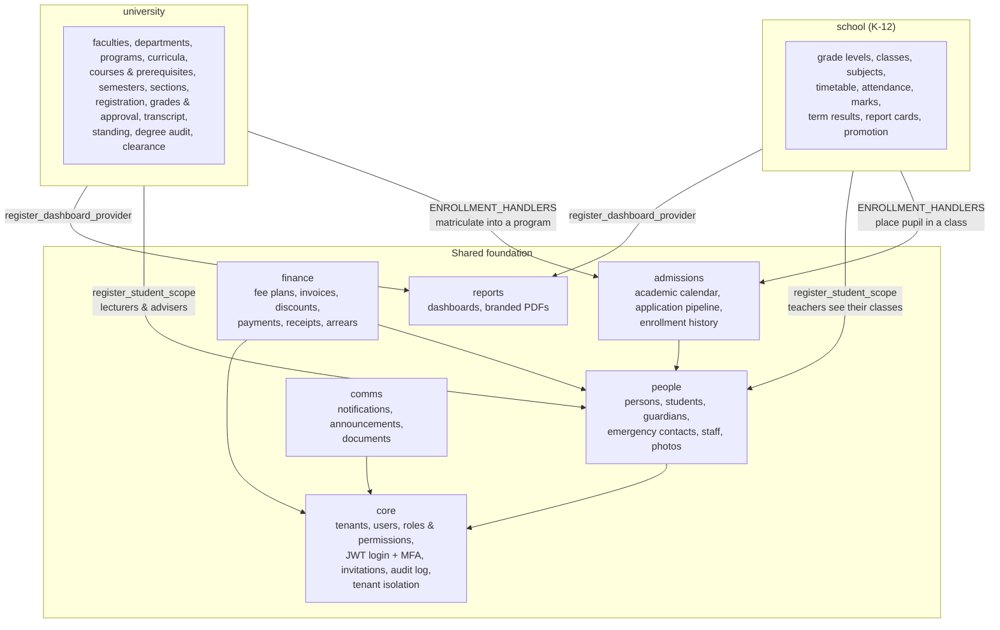
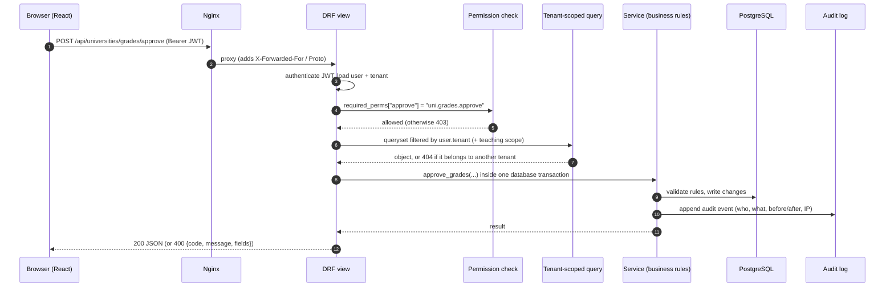
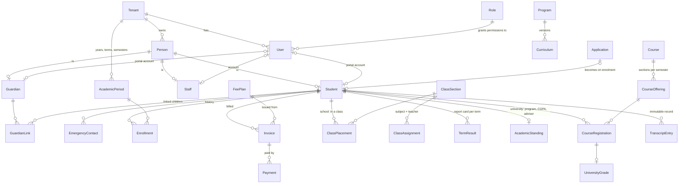
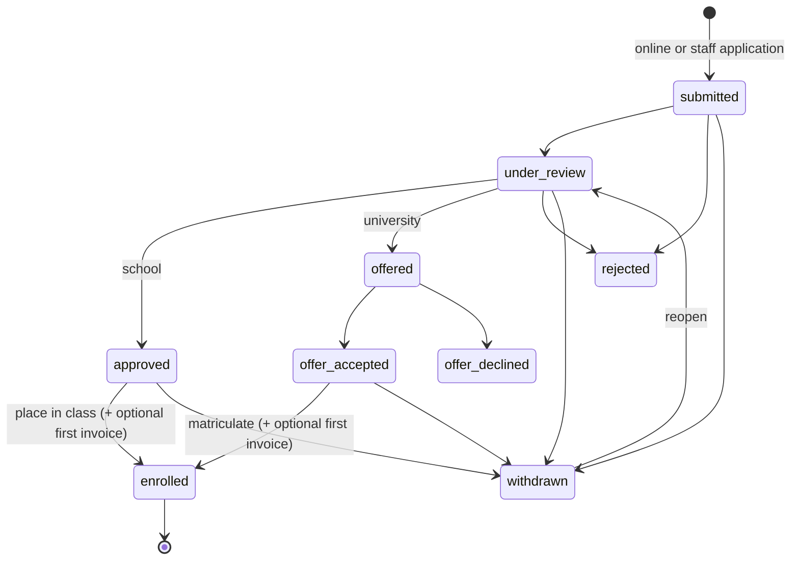
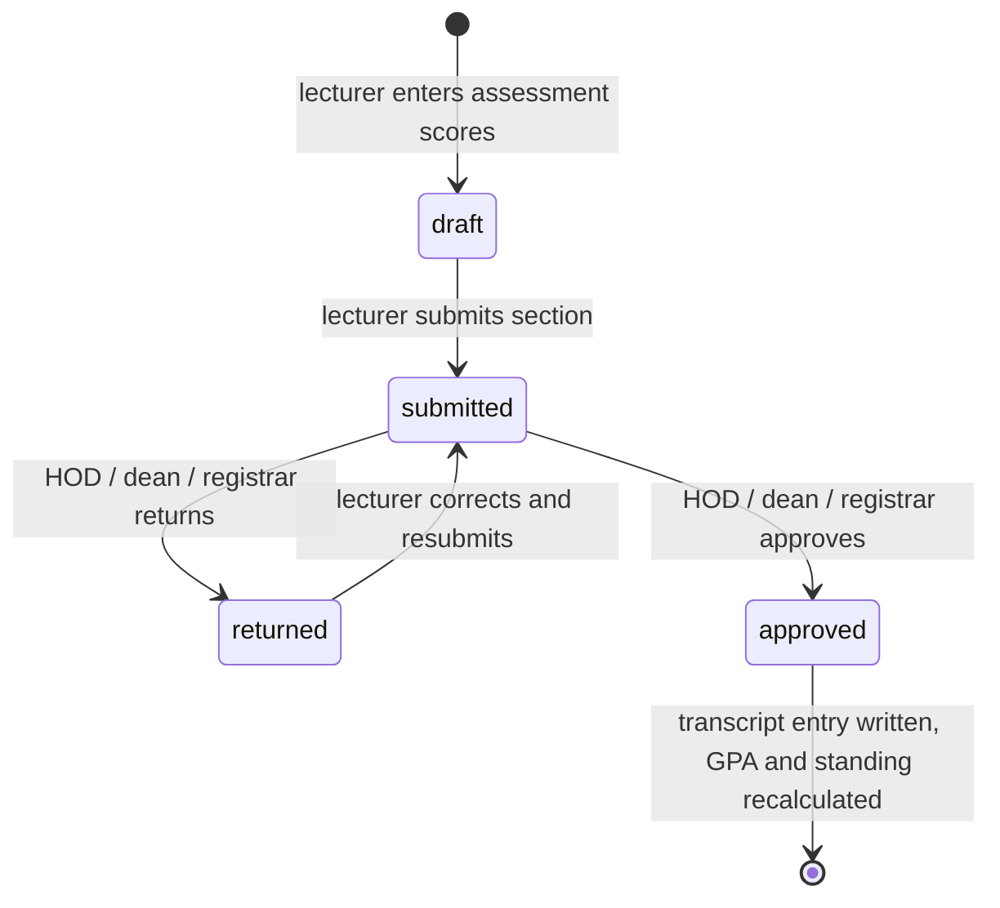
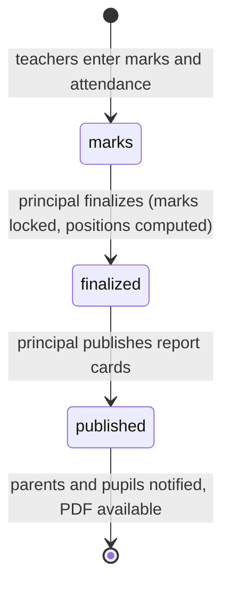
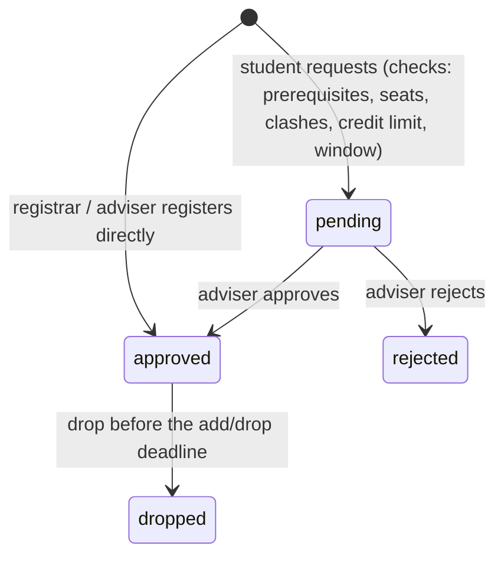
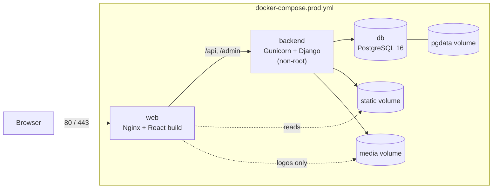

# Architecture

OmniEducation is one multi-tenant web platform for **schools (K-12)** and **universities**. Each institution is a
*tenant*: its own users, students, academic structure, fees, branding and audit log, isolated from every other
institution on the server side.

| Layer | Technology |
|---|---|
| Frontend | React 19 single-page app, Vite, React Router 7 |
| API | Django 5.2 + Django REST Framework, SimpleJWT, drf-spectacular (OpenAPI) |
| Database | PostgreSQL (16 or newer; SQLite only as a local fallback) |
| Web server | Nginx in front of Gunicorn; Docker Compose for a reproducible deployment |
| Documents | ReportLab (report cards, transcripts, ID cards, letters, receipts) |
| Email | Django email over SMTP (Gmail App password locally); console output in development |

Diagrams below are [Mermaid](https://mermaid.js.org/) and render on GitHub. Detailed tables:
[data-model.md](data-model.md). Roles: [roles.md](roles.md). Business rules: [school.md](school.md),
[university.md](university.md). Deployment: [deployment.md](deployment.md). Limitations: [limitations.md](limitations.md).

---

## 1. System overview



* The browser loads the React app once, then talks to the API with JSON over `/api/…`.
* Nginx never serves student photos or documents directly: they are streamed by the API after a permission check.
* In development, Vite (port 5173) plays Nginx's role and proxies `/api` to Django on port 8000.

## 2. Backend structure: a shared core with two pluggable modules

The brief requires K-12 logic (classes, terms, promotion) to stay separate from university logic (courses, credits,
semesters, transcripts). Shared apps own everything common; the two academic modules plug in through **hook
registries**, so the shared code never imports school- or university-specific code.



| Hook | Defined in | Used for |
|---|---|---|
| `TARGET_VALIDATORS`, `ENROLLMENT_HANDLERS` | `admissions/hooks.py` | What an applicant applies for, and what "enrol" means (class placement vs. program matriculation) |
| `register_student_scope` | `people/scoping.py` | Which students a teacher, lecturer or adviser may see |
| `register_dashboard_provider` | `reports/views.py` | Mode-specific dashboard numbers and charts |
| `seed.hooks` | `seed/hooks.py` | Demo data for each module |

Business rules live in **service functions** (`finance/services.py`, `school/services.py`,
`university/services.py`), not in views or serializers, so the API, the admin and the seed command all go through
the same checks. A broken rule raises `BusinessRuleViolation`, which the API returns as
`{"code", "message", "fields"}` with HTTP 400.

## 3. Request lifecycle and security checks



Every request is one database transaction (`ATOMIC_REQUESTS`): if any rule fails part-way, nothing from that request
is kept.

### Security controls

| Concern | Control |
|---|---|
| Tenant isolation | Every tenant-owned model inherits `TenantScopedModel`; every viewset uses `TenantScopedViewSetMixin`, which filters by the signed-in user's tenant. The tenant comes from the login, never from the request body. Foreign keys in request bodies are checked against the tenant too. Cross-tenant access returns 404. |
| Authorization | Role → permission matrix in `core/rbac.py` (see [roles.md](roles.md)); each action declares `required_perms`; undeclared actions are denied. Teaching and self-service scopes filter rows. |
| Authentication | JWT access tokens (30 min) + rotating refresh tokens, blacklisted on sign-out and on password change. Each browser tab keeps its own session. Optional TOTP two-factor sign-in. |
| Brute force | Login and password-reset throttling in Django, plus an Nginx rate limit on the login endpoint. |
| Passwords | Django's PBKDF2 hashing and password validators; reset links are single-use and expire in 1 hour; the reset endpoint never reveals whether an email exists. |
| Accounts | Staff, parents and students join by invitation (expiring token); roles allowed per institution mode. |
| Files | Photos are checked by content (real JPG/PNG only, 3 MB); documents by type (.pdf, .docx, .jpg, .png) and size (5 MB). All are stored under random names and served only through permission-checked endpoints; only institution logos are public. |
| Public application | `/api/public/…` needs no sign-in and is rate-limited per IP. It shows only institution names and what can be applied for. An applicant sees their own application only with its private 10-character reference code, can add a photo and documents only before a decision, cannot label an upload as an official document, and can only accept or decline an open offer. |
| Audit | Append-only `AuditEvent` (cannot be edited or deleted): sign-ins, failed sign-ins, data changes with before/after values, decisions, payments, exports, downloads. |
| Payments | Mock only: no card data is collected or stored; mock receipts are labelled as such. |
| Transport & headers | HTTPS via Nginx, HSTS and secure cookies in production, `X-Content-Type-Options`, `X-Frame-Options`, `Referrer-Policy`. |

## 4. Data model overview

The core relationships across the platform (all tables: [data-model.md](data-model.md)):



Design choices:

* **Person** holds personal data once; a person can be a student, a guardian and/or staff member.
* **Enrollment** is history, never overwritten: admission, promotion, repeat, transfer, withdrawal, graduation.
* **TranscriptEntry** and **GradeApproval** are append-only; an amended grade *supersedes* the old entry.
* **Invoice** balances are recalculated from lines, discounts and payments; payments lock the invoice row
  (`select_for_update`) so two cashiers cannot over-collect.
* Human-readable numbers (student, staff, application, invoice, receipt) continue from the highest number used.

## 5. Main workflows

### Admission (shared pipeline, mode-specific ending)



### University grades: separation of duties



### School term results



### Course registration



## 6. Frontend

```
frontend/src
  api/client.js        fetch wrapper: JWT per tab, silent refresh, structured errors, downloads
  auth/                AuthContext (session per tab), route guards
  config/              roles, navigation per role and mode
  components/          AppShell (sidebar, top bar, notifications), UI kit, CRUD cards
  pages/common/        dashboards, students, admissions, staff, fees, documents, reports, audit, profile
  pages/school/        classes, attendance, timetable, homework, marks, report cards, promotions, setup
  pages/university/    programs, offerings, registration, gradebook, approvals, transcript, degree audit, setup
  pages/platform/      institutions, tenant settings, administrator invitations
```

* The menu is built from the user's role and the institution's mode, but **the server is the authority**: hiding a
  button is a convenience, never a security control.
* Lists refresh when a tab regains focus; every form shows the server's field errors next to the field.

## 7. Deployment



On start the backend waits for PostgreSQL, runs migrations, collects static files and, if `SEED_DEMO=true` and the
database is empty, loads the demo school and university. See [deployment.md](deployment.md).
