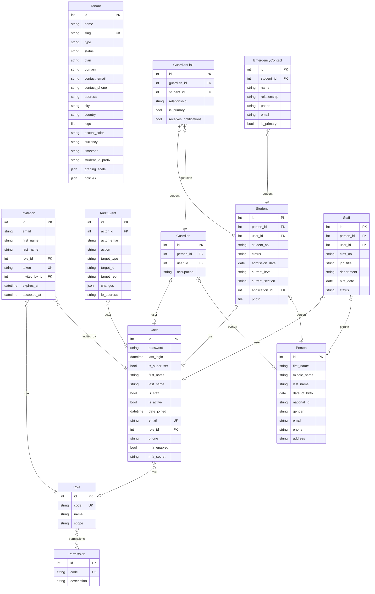
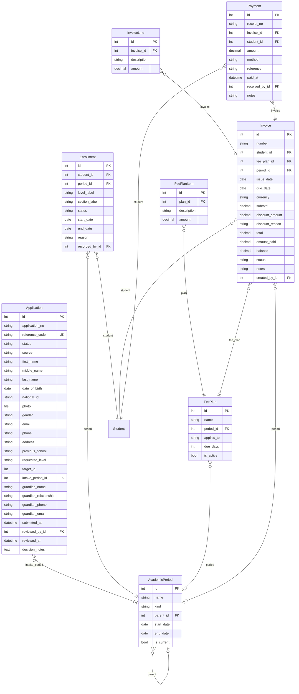
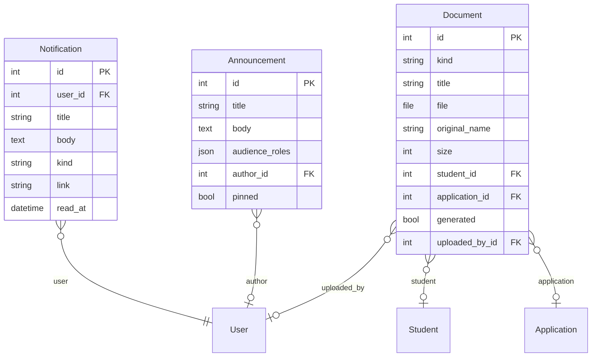
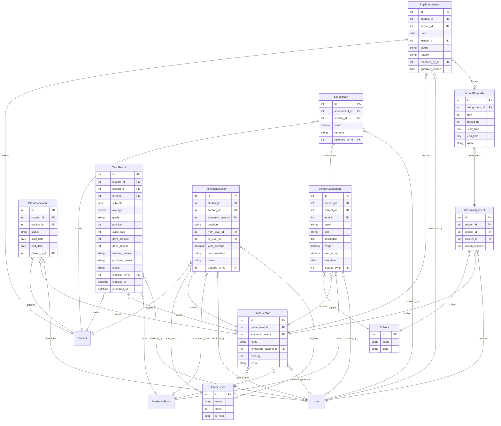
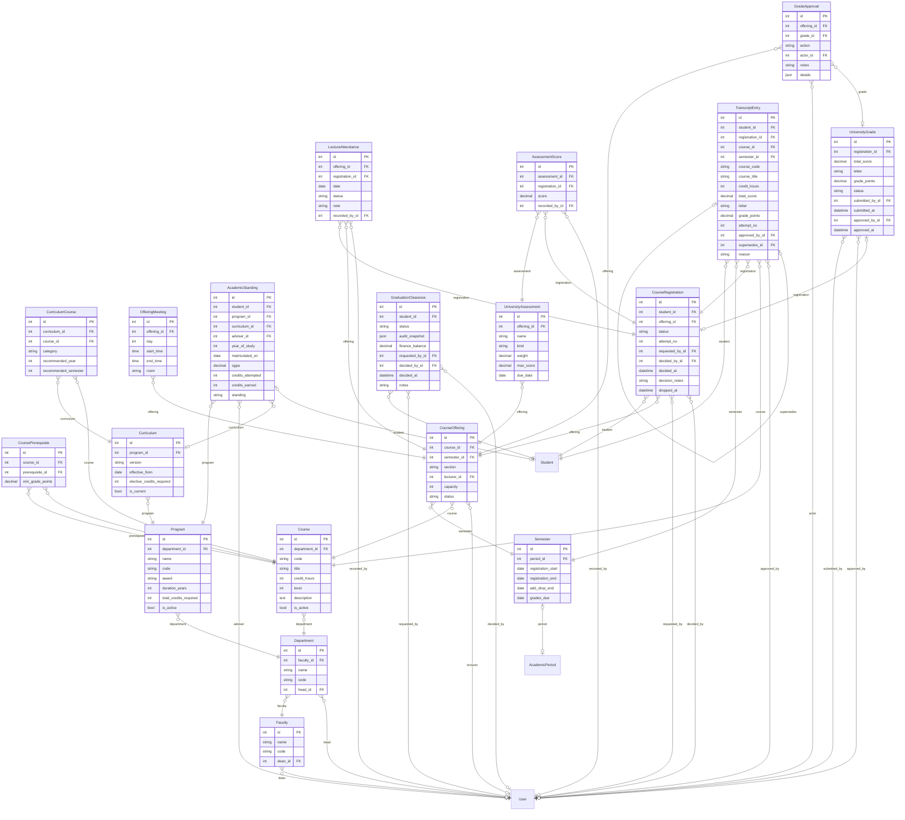

# Data model (ER diagrams)

Generated from the Django models with `python scripts/generate_er.py` (backend folder), so table names, keys and
relationships match the code. Every tenant-owned table also has `tenant_id → core_tenant` (omitted from
the diagrams to keep them readable) plus `created_at` / `updated_at`.

Database table name = `<app>_<model>` in lower case, e.g. `people.Student` → `people_student`.
53 tables in 7 apps. Start with the overview in [architecture.md](architecture.md#data-model-overview).

## Platform, people and accounts

## Admissions, calendar and finance

## Communication and documents

## School (K-12) module

## University module

